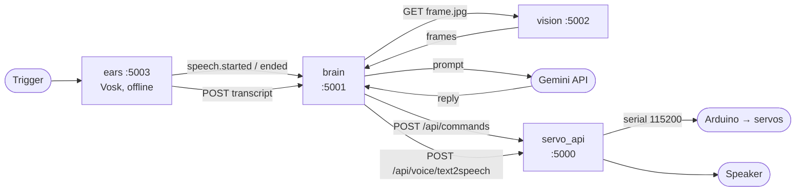

# Gary — an InMoov robot brain

Software for [Gary](https://inmoov.fr/), a 3D-printed InMoov humanoid. A Raspberry Pi
handles conversation, speech and vision; an Arduino drives the servos. Press a button,
talk to him, and he answers out loud while moving his mouth and head.

This started as a hackathon project in 2016 and has been rebuilt piecemeal ever since.
It is shared in the hope that it is useful to other InMoov builders — but read
[Known limitations](#known-limitations) first, because parts of it assume specific
hardware.

## How it works



Five processes, started together by `scripts/start_all.sh`:

| Service | Port | Responsibility |
|---|---|---|
| `servo_api/server.py` | 5000 | Owns the Arduino serial link; moves servos; text-to-speech |
| `brain/app.py` | 5001 | Coordinates. Prompts Gemini, decides when to look, drives speech |
| `vision/server.py` | 5002 | Owns the camera; serves frames to anything that needs to see |
| `ears/listener.py` | 5003 | Owns the microphone; triggers, recording, offline transcription |
| `console/server.py` | 5004 | Remote control page; proxies to the others |

Each hardware resource has exactly one owning service — serial port, camera,
microphone and button — because each can only be held by one process. Anything
else that needs them asks over HTTP.

A full exchange takes roughly 8 seconds: about 3 for the model, about 5 for speech.

**Start the servo API first.** The brain calls back into it for both speech and
servo movement, and will fail silently if it isn't listening.

## Hardware

- Raspberry Pi 4 (developed on Raspberry Pi OS 10 "buster", Python 3.7)
- Arduino with an Adafruit PCA9685 PWM driver, connected over USB serial at 115200 baud
- Google AIY Voice HAT — supplies the button, the LED and text-to-speech
- Raspberry Pi Camera Module on the CSI ribbon connector (optional; see limitations)

The Arduino firmware is **not** in this repository. It lives in
[ArduinoServoController-UART-InMoov](https://github.com/Lukeluca/ArduinoServoController-UART-InMoov),
and is treated here as a fixed API: the Pi sends it short ASCII commands (`HH:60`,
`HM+15`) over serial, two letters for the servo plus an absolute or relative value.
The `SERVOS[]` table in `UART_InMoov.ino` is the servo map: pins, travel limits
and per-servo calibration all live there, and deliberately nowhere on the Pi.
Positions are percentages of each joint's safe range precisely so this side does
not have to know that the right middle finger is mounted backwards.

## Setup

First flash the Arduino with
[ArduinoServoController-UART-InMoov](https://github.com/Lukeluca/ArduinoServoController-UART-InMoov)
— nothing here can move a servo without it. Then:

```bash
git clone <your-fork> gary
cd gary
cp brain/.env.example brain/.env
```

Add your [Google AI Studio key](https://aistudio.google.com/apikey) to `brain/.env`
as `GOOGLE_API_KEY`. Then install dependencies:

```bash
pip3 install -r servo_api/requirements.txt -r brain/requirements.txt \
            -r ears/requirements.txt -r vision/requirements.txt \
            -r console/requirements.txt
```

The AIY packages (`aiy.board`, `aiy.voice`) come from the Voice Kit system image, not
from pip.

## Running

```bash
./scripts/start_all.sh
```

Press and hold the button, speak, then release. Release is what ends the recording.

To verify the pipeline without a button press:

```bash
curl -X POST http://localhost:5001/ --data-urlencode "gary_prompt=say hello"
```

To stop everything:

```bash
pkill -f "[s]erver.py|[f]lask run|[l]istener.py"
```

### Starting automatically on power-on

```bash
./scripts/install-systemd.sh
systemctl --user start gary.target
```

That installs five units plus a `gary.target` that groups them, and enables
lingering so they come up at power-on without anyone logging in.

```bash
systemctl --user status gary-servo     # one service
systemctl --user stop gary.target      # all of them
sudo journalctl --user-unit gary-brain -f
```

These are deliberately **user** units rather than system units. The AIY
voiceHAT is held exclusively by PulseAudio, which runs inside the desktop
user's systemd session, so a system-scope service cannot reach the sound card:
`aplay` fails with "Device or resource busy" and text-to-speech returns a 500
while every other part of the pipeline looks healthy. Gary moves his mouth and
makes no sound. Running in the user session avoids that entirely.

## Vision

`vision/` owns the camera. Only one process can hold `/dev/video0`, so nothing
else opens it — everything that needs to see asks this service.

```
GET  /health           service and camera state
GET  /frame.jpg        one frame, as an image
GET  /frames?count=3   several frames, base64, for a multimodal prompt
POST /camera/release   drop the camera now, e.g. to free it for raspistill
```

The camera is opened on first use and released again after 30 seconds idle
(`GARY_CAMERA_IDLE_TIMEOUT`). Holding it open permanently would mean V4L2
queues buffers nobody reads, so a request after a long gap returns a frame
from seconds earlier; it also leaves a handle exposed to the legacy driver
wedging, and keeps the module's LED lit, which in a shared room reads as a
camera that is always recording. Measured on a Pi 4 with the v1 camera:

| | |
|---|---|
| Cold capture (opens the camera, 1.5s warmup) | ~2.0s |
| Warm capture (already open) | ~0.05s |
| Draining stale buffers after an idle gap | negligible |

That 40x gap is why a burst of frames is served without closing in between.
Components that genuinely need the camera held open — head tracking — take a
lease, which suppresses the idle release for as long as it is held.

Several images can go into a single Gemini request at roughly 1,100 tokens
each, and labelling them in the prompt works, so `/frames` is useful for a
wider effective view than the camera's field of view allows, or for asking
what changed between two moments.

### What Gary sees when you talk to him

The ears announce two facts — `speech.started` and `speech.ended` — and the
brain decides those moments are worth photographing. It grabs a frame on each,
holds them briefly, and attaches them to the next prompt.

The ears know nothing about cameras. That is deliberate: a robot built without
one runs the same ears unchanged, and the brain simply finds no vision service
and carries on with audio alone.

The frames are given to the model as *optional* context. The system prompt tells
Gary to use them only when they help answer what was actually said, and never to
remark on what he can see otherwise — so "how are you?" gets a normal answer
while "what is on the table?" gets a real one.

## Head tracking

Gary follows the largest face he can see, for as long as an interaction lasts.
It runs inside `vision/` rather than as its own service because it needs raw
frames: going out through `/frame.jpg` would cost a JPEG encode and decode,
about 59 ms, which is more than the detection itself.

**Nothing starts a session on its own.** Every trigger starts one — someone
speaking, or a button press with no words in it — and the console has a button
that does only this. A second trigger during a session extends it rather than
restarting anything, so a follow-up question buys more time without
interrupting the tracking already under way.

A session needs two clocks and no states: five seconds without a face ends it,
and 45 seconds since the last trigger ends it. That keeps the camera closed
except while someone is actually in front of him, and it means tracking never
outlives the conversation. It ends by letting go of the head, dropping the
camera lease, and playing `body_reset` — in that order, because the reset is a
gesture and outranks tracking, so resetting first would reach the pose and then
hand the head straight back to a tracker still aimed at a face.

Detection is deliberately cheap: 640 px wide with coarse parameters and no
preprocessing, about 38 ms, which finds a face at every distance from 1 to 4 m.
A session that cannot find anyone escalates once, after 1.5 s, to an equalised
pass at 960 px — the only thing that sees a badly lit face, but ~345 ms a frame
against the ordinary pass's ~38 ms, so about 3 fps. It belongs behind a failure
to acquire and never as a default, because equalisation *broke* detection on a
well-lit frame. Two consecutive detections must agree to within 0.12 of a frame
before anything moves, which is what stops a false positive on dark texture
from walking the head to the end of its travel.

### Where "looking at you" actually is

The camera is not on the head's rotation axis, so a face Gary is genuinely
aimed at does not land in the middle of the picture. Centring one there would
leave him pointing past people.

Worse, the offset is a physical displacement rather than an angular one, so how
far off-centre it lands **depends on distance** — a single correction cannot
serve both a close and a normal conversational distance. `SWEET_SPOTS` in
`vision/tracker.py` is therefore a small table keyed on how wide the face is as
a fraction of the frame, interpolated linearly between measured points and held
flat outside them rather than extrapolated.

Measure your own rather than copying these: aim the head at someone standing at
a given distance, read `last_raw` from `GET :5002/tracking`, and confirm the
detection is really a face before trusting the number — a careful-pass false
positive on an eye will otherwise calibrate you to the wrong thing.

## Voice

Gary speaks through Piper, a small neural text-to-speech model, falling back to
the AIY image's Pico voice if Piper is not installed. Pico dates from 2013 and
sounds like it.

```bash
./scripts/install-piper.sh
systemctl --user restart gary-servo
```

Everything lands in `~/gary-tts`; delete that directory to go back to Pico.
`servo_api/tts.py` picks the engine automatically, so a robot without Piper
still talks.

On 32-bit Raspberry Pi OS the install is not straightforward, and the script
explains why at length. In short: current Piper needs Python 3.9+ and only
ships 64-bit ARM wheels, and every standalone armv7 build - back to v1.0.0 -
needs a newer glibc than buster provides. The script fetches a bullseye glibc
into its own directory and runs Piper under that loader, leaving the system
alone.

| | Pico | Piper `alan-low`, `length_scale 0.75` |
|---|---|---|
| Synthesis | 0.12s | ~2.05s |
| Playback | 5.09s | 4.47s |
| Total per reply | ~5.4s | ~6.7s |

Piper is kept resident, because loading the voice costs ~1.5s and spawning per
reply pays it every time. Synthesis writes a file rather than streaming, which
is a deliberate choice measured on this Pi - `servo_api/tts.py` documents the
reasoning and what revisiting it would involve.

Voice and speed are configurable with `GARY_PIPER_VOICE` and
`GARY_PIPER_LENGTH_SCALE`; below 1.0 is faster speech.

## Gestures

Movement is a layered engine in `servo_api/motion.py` rather than one-shot
commands. It holds a pose model, ticks at 20 Hz, and eases between positions,
so a movement is a movement rather than a servo slamming to its target.

Gestures themselves are data, in `servo_api/gestures.yaml`:

```yaml
nod:
  keyframes:
    - at: 0.0
      HV: "+0"
    - at: 0.22
      HV: "-9"
    - at: 0.45
      HV: "+0"
```

A keyframe is a time in seconds plus the joints it moves. Adding a gesture is an
edit to that file, not a code change.

**Every value must be quoted.** Unquoted, YAML reads `HV: +7` as the number 7,
which means "go to 7% of travel" — near the bottom of the joint — rather than
"nudge 7% further on". The loader refuses bare numbers for exactly that reason.

| | |
|---|---|
| `"50"` | absolute, 50% of that joint's safe range |
| `"+7"` / `"-7"` | relative, exactly 7% on from where the joint started |
| `"+5..10"` | relative, a random 5 to 10% on |
| `"+/-5..10"` | relative, 5 to 10% in a direction picked at random |

Relative always means relative to the start of the gesture, never the previous
keyframe, so `"+0"` is "back where you began". A range is drawn once per play,
which is how one written-down gesture varies each time it runs.

```
GET  /api/motion/gestures            what he can do, and any load problems
POST /api/motion/gesture             {"name": "nod"}, or keyframes inline
GET  /api/motion/pose                where the engine believes he is
POST /api/motion/pose                {"joints": {"HH": 60}, "duration": 0.6}
POST /api/motion/nudge               {"joints": {"HH": 8}} relative, eased
POST /api/motion/stop                latch everything still
```

`/api/commands` is unchanged and still sends raw commands straight to the
Arduino. That is deliberate: it is the calibration path, and it should keep
behaving exactly like the firmware does, with no easing in the way.

The engine drives `HH`, `HV`, `RB`, `RW` and the five right fingers. It does not
drive the mouth — the speech path owns that — and a gesture naming `HM` is
rejected. Nothing self-initiates: there is no idle or breathing loop, because
continuous small movement keeps every servo energized and audibly buzzing, which
in a shared office is worse than stillness.

## Remote console

`http://<pi>:5004/` — a single page showing what Gary sees, with two boxes:

- **Ask Gary** goes to Gemini; he answers aloud and moves his mouth
- **Gary says** speaks text verbatim, with no model involved

The view polls `/api/frame.jpg` every two seconds rather than streaming, so the
vision service still releases the camera when nobody is watching. Polling stops
when the browser tab is hidden — otherwise a forgotten tab would hold the
camera open and leave the LED lit with nobody actually looking. A live stream
would be a later addition, taking a camera lease for the life of the
connection.

The console proxies rather than letting the browser call each service. That
keeps the brain bound to localhost instead of exposed to the network, avoids
CORS entirely, and keeps the user interface out of the services that own
hardware. The page has no external assets, so it renders on a robot with no
internet.

**There is no authentication.** Anyone who can reach port 5004 can move Gary
and make him speak. Consider where it is bound before exposing it.

### Triggers

Gary is never listening continuously; the ears record only when a trigger says
to. `GARY_TRIGGER` selects which, comma separated:

| | |
|---|---|
| `aiy` | The Voice HAT's button. Hold to talk. The default |
| `http` | `POST :5003/listen/start` and `/listen/stop`, so the brain can ask Gary to listen |
| `keyboard` | Enter to start, Enter to stop. For development, or a robot with no button |

A trigger that cannot be constructed — no AIY board present, say — is skipped
with a warning rather than stopping the service, so a partly equipped robot
still works. This is the seam to extend for a wake word or a GPIO button.

## Configuration

The model is set in `brain/app.py`. It currently uses `gemini-flash-lite-latest` —
an alias rather than a pinned version, deliberately: this project previously broke
when `gemini-1.5-flash` was retired, and pinning is not a safe harbour, since
retired models can be closed to new users entirely.

Gary's personality lives in **`brain/system_prompt.txt`** — plain text, sent as the
model's system instruction. It is the whole of what Gary is told about himself: who
he is, where he lives, who built him, when to use his camera, and how long his
answers may be. Edit that file to give your robot its own character; no Python
involved, which is the point, since a different InMoov in a different office is the
first thing anyone adapting this will want to change.

It is re-read for every question, so an edit takes effect on the next thing anyone
asks with nothing restarted — the same way the volume setting is re-read per
utterance. Override the location with `GARY_SYSTEM_PROMPT_FILE`. If the file is
missing or empty the brain logs a warning and falls back to a built-in one-line
prompt, so a robot with no persona file still answers; it just will not know its
own history.

Keep answers short in that file. Output length is the one thing that really governs
how the robot feels: the model generates in about half a second either way, but
every word gets spoken aloud, so the reply length sets the length of the wait.

## Known limitations

These are real and worth understanding before you invest time:

- **`/api/video` and `/api/video/stream` always return 500.** They are the last
  of the original camera attempt: the `Sight` class they call sits inside a
  string literal in `servo_api/gary_api.py`, so the name does not exist and the
  `sight` property raises `NameError` on every request. The servo API's own
  index page still links to one of them. Nothing else references either route.
  [Head tracking](#head-tracking) replaced all of it properly in `vision/`,
  which is where it has to live — only one process can hold `/dev/video0`, so a
  second `VideoCapture` inside `servo_api` would fight the vision service even
  if the code ran. The class, the property, both routes and the index link are
  all deletable together; deleting the class alone would leave the callers
  dangling.
- **Requires the AIY Voice HAT.** The button, LED and text-to-speech all come from
  `aiy.*`. Without that discontinued board the code fails at import. Making this
  portable means abstracting a trigger source and a TTS backend.
- **The mouth does not articulate.** It opens, holds through the whole utterance,
  then closes — there is no lip-sync.
- **`archive/`** holds superseded code kept for reference. It is not wired up.

## Layout

```
brain/       conversation: Gemini, speech recognition, web UI
servo_api/   motion and speech output; owns the Arduino serial link
  motion.py     the pose model, tick loop and layers
  gestures.yaml the gestures themselves, as data
scripts/     start_all.sh
archive/     superseded earlier versions, not in use
```

## License

MIT — see [LICENSE](LICENSE).

One bundled exception: `vision/haarcascade_frontalface_default.xml` is OpenCV's
frontal-face cascade, under the Intel License Agreement whose text is in the
file's own header. It is vendored because OpenCV 3.2 ships no cascade data, so
there is nothing on the system to load — see [Head tracking](#head-tracking).
